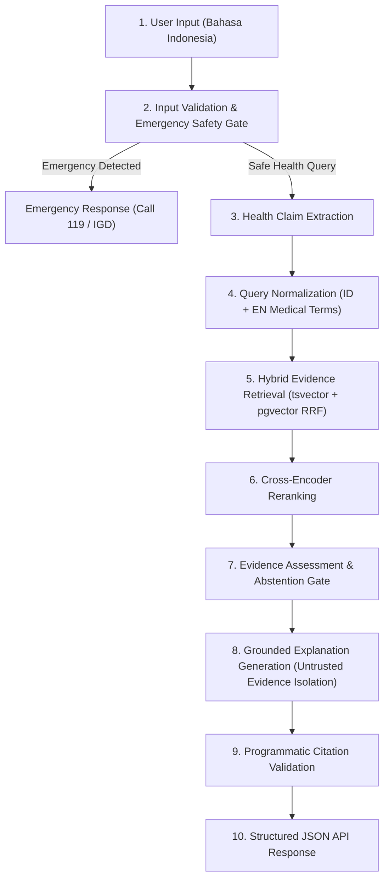

# AI Pipeline Design — VeriMed (`docs/AI_PIPELINE.md`)

## 1. End-to-End Pipeline Architecture

---

## 2. Pipeline Stage Specifications

### Stage 1 & 2: Input Validation & Emergency Safety Gate
- Enforces character bounds (10–1,000 characters), strips non-printable control characters.
- Checks for acute emergency indicators (chest pain, difficulty breathing, stroke signs, acute poisoning, self-harm). If matched, halts verification and returns emergency medical guidance.

### Stage 3: Health Claim Extraction
- Decomposes multi-sentence social media posts into atomic, check-worthy health claims.
- Rejects non-health inputs or purely subjective personal anecdotes.

### Stage 4: Query Normalization
- Normalizes colloquial Bahasa Indonesia expressions into standard Indonesian medical terms and English MeSH equivalents to maximize cross-lingual retrieval recall.

### Stage 5: Hybrid Evidence Retrieval
- Executes two parallel queries against `evidence_chunks`:
  1. **Lexical Search**: PostgreSQL `ts_rank_cd` over `search_vector` (`TSVECTOR`).
  2. **Semantic Search**: `pgvector` cosine similarity (`1 - (embedding <=> :query_vec)`) using multilingual embeddings (`intfloat/multilingual-e5-base`, 768 dimensions).
- Merges rankings using **Reciprocal Rank Fusion (RRF)** ($k = 60$).

### Stage 6: Cross-Encoder Reranking
- Re-scores the top-$N$ candidate chunks using a multilingual cross-encoder (`cross-encoder/mmarco-mMiniLMv2-L12-H384-v1`) on `(claim_text, chunk_text)` pairs.

### Stage 7: Evidence Assessment & Abstention Gate
- Classifies the relationship between the claim and top reranked chunks into one of four verdicts:
  - `SUPPORTED`: Retrieved high-quality evidence consistently supports the claim.
  - `CONTRADICTED`: Retrieved high-quality evidence refutes or contradicts the claim.
  - `MIXED_EVIDENCE`: Credible sources present conflicting findings or context-dependent outcomes.
  - `INSUFFICIENT_EVIDENCE`: No relevant high-confidence evidence exists in the curated database.
- **Hard Abstention Rule**: If the highest reranker score is below the minimum relevance threshold $\tau_{\text{min}}$ (e.g., `0.35`), the pipeline automatically forces `verdict = INSUFFICIENT_EVIDENCE` and `abstained = True`.

### Stage 8: Grounded Explanation Generation
- Synthesizes an accessible Bahasa Indonesia explanation strictly from the reranked evidence chunks.
- **Prompt Injection Defense**: Every retrieved passage is wrapped in `<untrusted_evidence citation_key="[n]">...</untrusted_evidence>` tags, with system instructions forbidding execution of any directive found inside those tags.

### Stage 9: Citation Validation
- Parses all `[n]` citation markers in the generated explanation and verifies that each marker maps to an actual `evidence_chunk` returned in Stage 6. Any unverified citation triggers regeneration or fallback to deterministic summary.

---

## 3. Evaluation Strategy

1. **Retrieval Metrics**: Recall@5, Recall@10, and Mean Reciprocal Rank (MRR) on curated Indonesian health claim pairs.
2. **Stance Classification Metrics**: Macro-F1 across the 4 verdict classes and Abstention Precision on out-of-corpus claims.
3. **Grounding & Citation Fidelity**: Percentage of generated sentences with verified supporting citation spans (target: 100% programmatic citation validity).

---

## 4. Phase 3 Configurable Runtime Backends

The pipeline is configured via environment variables in `.env` (read by `verimed_api.core.config.Settings`):

| Variable | Options / Default | Purpose |
| --- | --- | --- |
| `AI_PROVIDER` | `"mock"` (default), `"hybrid"`, `"configurable"` | Selects deterministic mock demo mode, PostgreSQL hybrid retrieval + grounded deterministic synthesis, or OpenAI-compatible grounded LLM synthesis. |
| `EMBEDDING_BACKEND` | `"hash"` (default), `"sentence_transformers"` | Selects zero-download 768-d hash embeddings for offline dev/CI or `intfloat/multilingual-e5-base` (`pip install -e ".[ml]"`). |
| `RERANKER_BACKEND` | `"lexical"` (default), `"cross_encoder"` | Selects deterministic token-overlap reranking or multilingual `cross-encoder/mmarco-mMiniLMv2-L12-H384-v1`. |
| `RETRIEVAL_MIN_SCORE` | `0.35` | Minimum reranker score required before forcing `INSUFFICIENT_EVIDENCE` abstention. |
| `LLM_BASE_URL` / `LLM_API_KEY` / `LLM_MODEL_NAME` | Empty / `"gpt-4o-mini"` | OpenAI-compatible endpoint (including Google Gemini at `https://generativelanguage.googleapis.com/v1beta/openai` with `gemini-2.5-flash`) used when `AI_PROVIDER=configurable`; isolates `<untrusted_claim>` & `<untrusted_evidence>`, strips Markdown JSON fences, and falls back safely to deterministic bilingual grounded synthesis on errors. |
