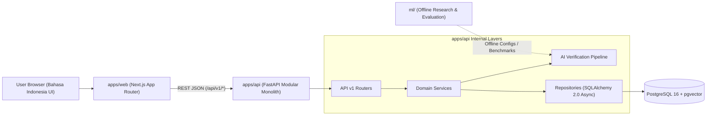

# Architecture Specification — VeriMed (`docs/ARCHITECTURE.md`)

## 1. Architectural Pattern: Modular Monolith

VeriMed adopts a **Modular Monolith** architecture organized within a single monorepo (`verimed-ai`). This provides strong domain boundaries, independent testability, and straightforward local/container deployment without the operational overhead of premature microservices.

---

## 2. Monorepo Structure & Boundaries

| Directory | Responsibility | Allowed Dependencies |
| :--- | :--- | :--- |
| `apps/web/` | Next.js frontend, feature modules, TanStack Query state, Zod client validation | Public REST API (`/api/v1/*`) only. Never accesses DB directly. |
| `apps/api/` | FastAPI HTTP layer, domain services, AI pipeline orchestration, SQLAlchemy repositories, Alembic migrations | PostgreSQL (`asyncpg`), configured AI providers. Never imports from `ml/` or `apps/web/`. |
| `ml/` | Offline embedding benchmarks, retrieval evaluation, synthetic/curated dataset preparation | Standalone research scripts. |
| `infra/docker/` | Container build definitions and PostgreSQL `pgvector` initialization scripts | Referenced by `compose.yaml`. |
| `docs/` | Living engineering, database, API, safety, and product documentation | Source of truth for architecture. |

---

## 3. Backend Layering (`apps/api`)

1. **`api/v1/endpoints/`**: Thin FastAPI routers. Responsible only for parsing HTTP requests, invoking dependency-injected services, and returning typed `ApiResponse[T]` schemas.
2. **`schemas/`**: Pydantic v2 data transfer objects, standardized response envelopes, and error payloads.
3. **`services/`**: Application use-case coordination (e.g., `HealthService`, `VerificationService`).
4. **`pipeline/`**: Pluggable AI stages (`ClaimExtractor`, `QueryNormalizer`, `HybridRetriever`, `CrossEncoderReranker`, `EvidenceAssessor`, `GroundedExplainer`, `CitationValidator`).
5. **`repositories/`**: Encapsulates all SQLAlchemy `AsyncSession` queries, vector cosine distance (`<=>`), and full-text search (`tsvector`).
6. **`models/`**: SQLAlchemy 2.0 ORM declarative models mapping to PostgreSQL tables.
7. **`core/`**: Configuration (`Pydantic Settings`), database session factory, structured logging, security utilities, and global exception handlers.

---

## 4. Frontend Layering (`apps/web`)

1. **`src/app/`**: Next.js App Router pages and layouts (`/`, `/verify`, `/about`).
2. **`src/features/`**: Domain-scoped modules (`system-status`, `verification`) containing:
   - `api/`: Typed fetch functions and TanStack Query hooks.
   - `components/`: Feature UI components.
   - `schemas/`: Zod runtime validation schemas matching backend contracts.
3. **`src/components/`**: Shared layout (`Header`, `Footer`, `MedicalDisclaimerBanner`) and accessible UI primitives.
4. **`src/lib/`**: Shared HTTP client (`api-client.ts`) and validated environment config (`env.ts`).
