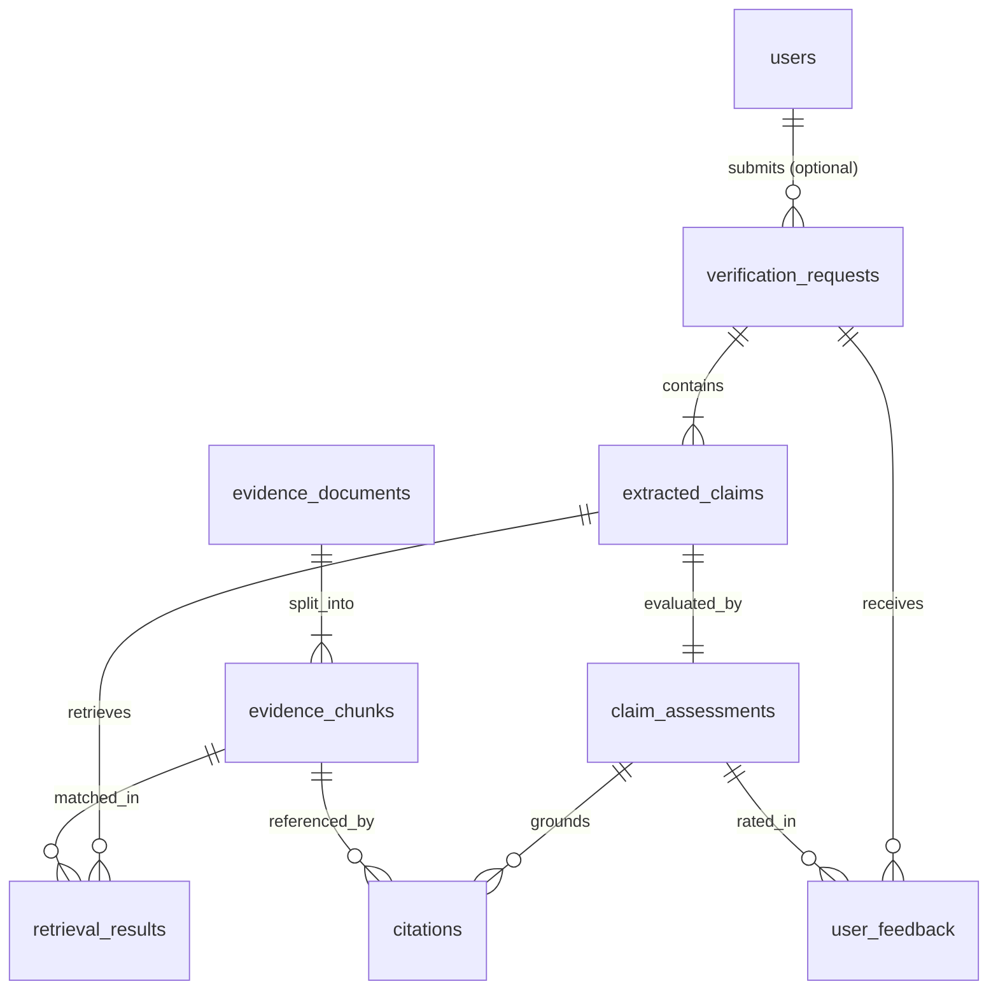

# Database Specification — VeriMed (`docs/DATABASE.md`)

## 1. Database Engine & Extensions

- **Engine**: PostgreSQL 16 (`pgvector/pgvector:pg16`)
- **Required Extensions**:
  - `vector`: Enables `VECTOR(768)` column storage and HNSW cosine similarity indexing (`vector_cosine_ops`).
  - `pg_trgm`: Enables trigram similarity indexing for typo-tolerant Indonesian lexical matching.
- **ORM & Migrations**: SQLAlchemy 2.0 (`AsyncSession` via `asyncpg`) + Alembic.

---

## 2. Entity-Relationship Overview

---

## 3. Relational Schema Definitions

All tables include:
- `id`: `UUID` (Primary Key, default `uuid4`)
- `created_at`: `TIMESTAMPTZ` (default `now()`, indexed where appropriate)
- `updated_at`: `TIMESTAMPTZ` (default `now()`)

### 3.1 `users` (Future Authentication Support)
Stores minimal account metadata for future opt-in authentication. Not required for public MVP claim verification.
- `email_hash` (`VARCHAR(128)`, unique, indexed)
- `role` (`VARCHAR(32)`, default `'public'`)
- `is_active` (`BOOLEAN`, default `true`)

### 3.2 `verification_requests`
Represents a single user verification submission.
- `user_id` (`UUID`, nullable FK -> `users.id`, `ON DELETE SET NULL`)
- `input_text` (`TEXT`, not null)
- `language_code` (`VARCHAR(10)`, default `'id'`)
- `status` (`VARCHAR(32)`, indexed: `'PENDING' | 'COMPLETED' | 'EMERGENCY_HALT' | 'FAILED'`)
- `is_private` (`BOOLEAN`, default `true` — private by default)
- `is_demonstration` (`BOOLEAN`, default `true` — marks mock/synthetic mode)
- `emergency_triggered` (`BOOLEAN`, default `false`)
- `processing_time_ms` (`INTEGER`, nullable)
- `model_version` (`VARCHAR(64)`, not null)

### 3.3 `extracted_claims`
Atomic verifiable claims extracted from a `verification_request`.
- `request_id` (`UUID`, FK -> `verification_requests.id`, `ON DELETE CASCADE`, indexed)
- `claim_index` (`INTEGER`, not null)
- `claim_text` (`TEXT`, not null)
- `normalized_query` (`TEXT`, not null)

### 3.4 `evidence_documents`
Curated authoritative medical sources (e.g., Kemenkes RI, WHO, BPOM, peer-reviewed journals).
- `source_name` (`VARCHAR(128)`, not null, indexed)
- `source_url` (`TEXT`, not null)
- `title` (`TEXT`, not null)
- `authors` (`TEXT`, nullable)
- `publication_date` (`DATE`, nullable, indexed)
- `retrieved_at` (`TIMESTAMPTZ`, not null)
- `language_code` (`VARCHAR(10)`, default `'id'`)
- `source_type` (`VARCHAR(64)`, not null, indexed)
- `content_hash` (`VARCHAR(64)`, unique, not null)
- `content_version` (`INTEGER`, default `1`)
- `is_synthetic_demo` (`BOOLEAN`, default `false`)

### 3.5 `evidence_chunks`
Passages segmented from `evidence_documents` for hybrid search.
- `document_id` (`UUID`, FK -> `evidence_documents.id`, `ON DELETE CASCADE`, indexed)
- `chunk_index` (`INTEGER`, not null)
- `chunk_text` (`TEXT`, not null)
- `token_count` (`INTEGER`, not null)
- `embedding` (`VECTOR(768)`, nullable in mock mode, HNSW indexed)
- `search_vector` (`TSVECTOR`, nullable, GIN indexed)
- `content_version` (`INTEGER`, default `1`)

### 3.6 `retrieval_results`
Audit record of candidate chunks retrieved and reranked for an `extracted_claim`.
- `claim_id` (`UUID`, FK -> `extracted_claims.id`, `ON DELETE CASCADE`, indexed)
- `chunk_id` (`UUID`, FK -> `evidence_chunks.id`, `ON DELETE CASCADE`, indexed)
- `lexical_score` (`FLOAT`, default `0.0`)
- `vector_score` (`FLOAT`, default `0.0`)
- `hybrid_score` (`FLOAT`, default `0.0`)
- `rerank_score` (`FLOAT`, nullable)
- `rank_position` (`INTEGER`, not null)
- `retrieved_at` (`TIMESTAMPTZ`, not null)

### 3.7 `claim_assessments`
The pipeline's evaluation of an `extracted_claim` against retrieved evidence.
- `claim_id` (`UUID`, unique FK -> `extracted_claims.id`, `ON DELETE CASCADE`)
- `verdict` (`VARCHAR(32)`, indexed: `'SUPPORTED' | 'CONTRADICTED' | 'MIXED_EVIDENCE' | 'INSUFFICIENT_EVIDENCE'`)
- `confidence_score` (`FLOAT`, not null)
- `abstained` (`BOOLEAN`, default `false`)
- `abstention_reason` (`TEXT`, nullable)
- `explanation_text` (`TEXT`, not null — grounded Bahasa Indonesia explanation)
- `uncertainty_notes` (`TEXT`, not null)
- `model_name` (`VARCHAR(128)`, not null)
- `prompt_version` (`VARCHAR(32)`, not null)

### 3.8 `citations`
Maps specific claims/statements inside a `claim_assessment` to `evidence_chunks`.
- `assessment_id` (`UUID`, FK -> `claim_assessments.id`, `ON DELETE CASCADE`, indexed)
- `chunk_id` (`UUID`, FK -> `evidence_chunks.id`, `ON DELETE RESTRICT`, indexed)
- `citation_key` (`VARCHAR(16)`, not null, e.g., `"[1]"`)
- `stance` (`VARCHAR(32)`, not null: `'SUPPORTING' | 'CONTRADICTING' | 'CONTEXTUAL'`)
- `quoted_span` (`TEXT`, nullable)

### 3.9 `user_feedback`
Captures anonymous user ratings on explanation clarity.
- `request_id` (`UUID`, FK -> `verification_requests.id`, `ON DELETE CASCADE`, indexed)
- `assessment_id` (`UUID`, nullable FK -> `claim_assessments.id`, `ON DELETE SET NULL`)
- `is_helpful` (`BOOLEAN`, not null)
- `feedback_category` (`VARCHAR(64)`, nullable)
- `comment_sanitized` (`VARCHAR(500)`, nullable)

---

## 4. Privacy & Data Minimization Principles

1. **No PHI Storage**: Users are warned not to submit personal medical records or national IDs (NIK).
2. **Private by Default**: `verification_requests.is_private` defaults to `TRUE` so user queries are never publicly listed.
